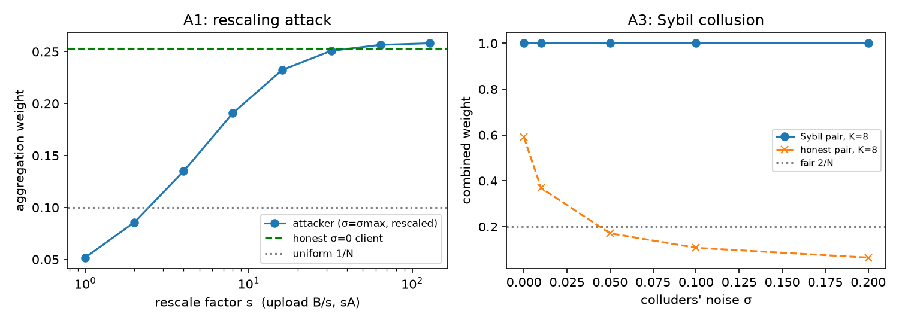
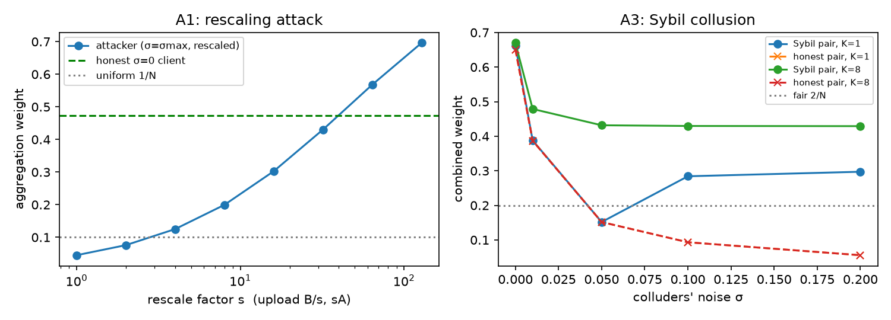

# Attacks on WinFLoRA's noise-aware aggregation

WinFLoRA (WWW '26) pays clients in aggregation weight for adding less privacy noise to their LoRA uploads. The server estimates each client's noise level by leave-one-out PCA on the LoRA-B matrices. This branch adds three attacks on that mechanism and evaluates them on 10 real TinyLlama-1.1B LoRA clients trained on AG News with the repo's defaults. Every result is reported twice: once for the released code's estimator ("repo") and once for Algorithm 1 as written in the paper ("paper"). Two attacks work at the method level. A1 (rescaling) moves a maximum-noise client from last to first place. A3 (Sybil pair) takes 100% of the weight under the paper's estimator. In both cases global accuracy drops to chance. The third, A2, is an implementation flaw: the fixed noise seed lets anyone recover a client's clean adapter.

## Attacks

- **A1: rescaling.** The attacker adds maximum noise, then uploads (B/s, s·A). The product ΔW = BA does not change, but the noise estimate looks only at B, so it shrinks by a factor of s and the attacker's weight goes up.
- **A2: fixed noise seed.** `utils.add_noise_to_lora` seeds its Gaussian with `1234 + cid`, so a client gets the same noise vector every round. Two uploads at different σ are enough to solve for the clean adapter, even when σ is unknown.
- **A3: Sybil pair.** Two colluding clients upload identical updates. Under the paper's K = N−2, each twin lies in the other's leave-one-out subspace, so its residual (estimated noise) is about zero.
- **Estimator deviation.** `rpca.py` recomputes the mean from an already-centred matrix, so x_i is never centred. That departs from Algorithm 1, line 11. The repo also defaults to K = 1, and `sigma_max = 0.1` makes the largest noise level about 240× a trained update.

## Reproduce

Environment: Python 3.10+, torch with CUDA, `transformers`, `peft`, `datasets`, `scikit-learn`, plus the repo's own requirements. All commands run from `Src/`.

```bash
python scripts/remote_setup.py      # fetch TinyLlama-1.1B-Chat-v1.0 and AG News into Src/models, Src/datasets
python tiny_pca_greedy_agnews.py --times 1 --run_serial True --load_artifacts True > train_agnews.log 2>&1
python attack_sim.py --source artifacts --num_clients 10 --estimator repo  --out attack_results
python attack_sim.py --source artifacts --num_clients 10 --estimator paper --out attack_results
python eval_attacks.py --n_eval 600 --out attack_results/eval_attacks.json
```

`scripts/after_training.sh` waits for training to finish and then runs both `attack_sim.py` commands. `scripts/status.sh` reports training progress. `attack_sim.py --source synthetic` runs without a GPU, using random adapters with TinyLlama's LoRA shapes. Training cached the adapters in `Src/noisy_tiny_agnews/artifacts/client_*/lora.pt`; they are not committed. The results below are in `Src/final_results/`.

## Results (10 clients, AG News)

Repo one-round noisy global model: 0.445 accuracy on the 2400-sample global validation set.

### A1: rescaling, attacker at σ = 0.1

| s | repo σ̂ | repo weight (rank) | paper σ̂ | paper weight (rank) |
|---|---|---|---|---|
| 1 | 0.0999 | 0.045 (10/10) | 0.1003 | 0.052 (10/10) |
| 4 | 0.0250 | 0.125 (2) | 0.0263 | 0.135 (2) |
| 16 | 0.0062 | 0.303 (1) | 0.0103 | 0.232 (1) |
| 128 | 0.0008 | **0.696 (1)** | 0.0082 | **0.258 (1)** |

Reference: an honest noiseless client gets 0.474 (repo) / 0.253 (paper). The uniform share is 0.100.

### A2: fixed seed (relative error over all LoRA tensors of client 1)

| σ t → t′ | one upload | recovered, σ known | recovered, σ unknown | control: fresh noise |
|---|---|---|---|---|
| 0.05 → 0.01 | 4.68 | 8.5e-8 | 1.7e-4 | 0.92 |
| 0.10 → 0.05 | 9.36 | 3.8e-7 | 1.7e-4 | 4.19 |
| 0.10 → 0.001 | 9.36 | 2.7e-8 | 1.7e-4 | 0.09 |

### A3: Sybil pair (fair share 2/N = 0.20)

| colluders' σ | repo pair (K=1) | repo, honest pair | paper pair (K=8) | paper, honest pair |
|---|---|---|---|---|
| 0.00 | 0.662 | 0.651 | **1.000** | 0.591 |
| 0.01 | 0.388 | 0.387 | **1.000** | 0.369 |
| 0.05 | 0.152 | 0.152 | **1.000** | 0.171 |
| 0.10 | 0.284 | 0.093 | **1.000** | 0.108 |
| 0.20 | 0.297 | 0.056 | **1.000** | 0.065 |

### Accuracy impact (one round, fixed 600-sample subset of the global validation set)

| configuration | repo: attacker weight | repo acc | paper: attacker weight | paper acc |
|---|---|---|---|---|
| uniform average, clean adapters | 0.10 | 0.848 | - | - |
| uniform average, honest noise | 0.10 | 0.353 | - | - |
| honest round | - | 0.442 | - | 0.578 |
| σ=0.1: A1 control, s=1 | 0.045 | 0.232 | 0.052 | 0.262 |
| σ=0.1: A1, s=128 | 0.694 | 0.242 | 0.260 | 0.242 |
| σ=0.1: A3 Sybil pair | 0.282 (pair) | 0.242 | 1.000 (pair) | 0.242 |
| σ=0.05: attacker honest | 0.075 | 0.335 | 0.085 | 0.508 |
| σ=0.05: A1, s=128 | **0.798** | **0.242** | **0.260** | **0.230** |
| σ=0.05: pair honest | 0.150 (pair) | 0.335 | 0.170 (pair) | 0.508 |
| σ=0.05: A3 Sybil pair | 0.150 (pair) | 0.258 | **1.000 (pair)** | **0.242** |

At σ = 0.1, a single max-noise client already collapses the model even at its fair weight, so those rows cannot separate the attack from the noise. The σ = 0.05 rows can: rescaling leaves ΔW unchanged and alters only the weights, and accuracy still falls to chance.




### Caveats

- One aggregation round, one noise draw, one data split. With 600 evaluation samples, accuracies carry about ±2 points of standard error.
- A3 is weak under the released K = 1 estimator at low noise. The 100% capture holds for the paper's K = N−2.
- A2 is an implementation flaw. Fresh noise each round fixes it.

## Credit

The base code is from https://github.com/koums24/WinFLoRA by the paper's authors. This branch adds only `attack_sim.py`, `eval_attacks.py`, `Src/scripts/`, `Src/final_results/`, this file and `.gitignore`. The authors' files are unchanged apart from a link to this file at the top of `readme.md`.
